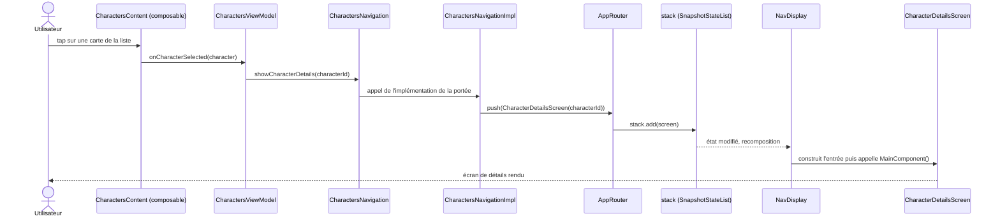

# Rick & Morty API — Le système de navigation du module `:app`

## 1. Présentation du projet

Ce dépôt contient une application Android **Rick & Morty API** écrite en **Kotlin** et
**Jetpack Compose**, organisée en architecture propre : une couche `data` (Ktor, Room), une
couche `domain` (modèles et dépôts), une couche `presentation` (contrats) et une couche `ui`.
L'application consomme l'API publique Rick and Morty pour afficher la liste des personnages et
le détail de chacun d'eux. Tout le code présenté ici se trouve dans le module **`:app`**
(paquet `org.mathieu.cleanrmapi`).

La navigation est implémentée avec la bibliothèque **Navigation3**
(`org.jetbrains.androidx.navigation3:navigation3-ui`) : il n'y a plus ni chaîne de route, ni
`NavHost(route = ...)`, ni `rememberNavController()` dans l'application.

> **Ce document porte uniquement sur le système de navigation du module `:app`** : qui possède
> la pile d'arrière-plan (*back stack*), pourquoi la clé de navigation est l'écran lui-même, et
> comment un appui utilisateur se transforme en mutation de pile.

Tous les extraits de code sont recopiés **verbatim** (à l'identique) depuis les fichiers
indiqués ; les chemins sont donnés par rapport à la racine du dépôt. Les identifiants de code
(`NavScreen`, `AppRouter`, etc.) restent en anglais, comme dans la source.

---

## 2. Vue d'ensemble — le cycle complet de navigation

Le chemin d'un appui utilisateur jusqu'au rendu de l'écran suivant, puis le retour :

1. **L'utilisateur appuie** sur un élément d'interface. Le commentaire du code résume le
   chemin en `(UiAction -> VM -> intention)` — il n'existe *aucune* classe nommée `UiAction` :
   l'action utilisateur est un *callback* Compose qui appelle la ViewModel.
2. **La ViewModel reçoit l'action** (`CharactersViewModel.onCharacterSelected`) et appelle
   **une intention de navigation** : `CharactersNavigation.showCharacterDetails(characterId)`.
3. **L'intention est un contrat** déclaré sous `presentation/navigation`. La ViewModel ne
   connaît ni le routeur, ni la pile, ni la mécanique de navigation.
4. **L'implémentation de la portée** (`CharactersNavigationImpl`, dans
   `ui/navigation/impl/`), qui détient le routeur, traduit l'intention en opération :
   `router.push(CharacterDetailsScreen(characterId))`.
5. **`AppRouter` mute la pile** — la `SnapshotStateList<NavScreen>` détenue par
   `AppScopeViewModel`. L'état change, Compose recompose.
6. **`NavDisplay` (hébergé par `AppNavHost`) observe la pile** : il construit une entrée pour
   la clé du sommet (`entryProvider = { key -> NavEntry(key) { key.MainComponent() } }`) et
   affiche le contenu de cette entrée.
7. **L'écran autoporté se rend lui-même** : `MainComponent()` crée sa ViewModel avec
   `viewModel()` et compose sa vue. Aucun `when` sur les clés n'est nécessaire.

Le retour suit la même chaîne, à l'envers, par deux voies : la **touche retour système**
(gestionnaire installé par `NavDisplay`, câblé sur `onBack = scopeViewModel.router::pop`) ou
la **flèche de la barre supérieure (TopAppBar)** de l'écran de détails (intention
`CharacterDetailsNavigation.goBack()`).

### Diagramme de séquence



### États de la pile (illustration ASCII)

Convention : la **fin** de la liste est le sommet, c'est-à-dire l'écran que `NavDisplay` rend.

```text
démarrage     [ CharactersScreen ]
                    │  tap sur la carte « character 42 »
                    │  showCharacterDetails(42) → router.push(...)
                    ▼
push          [ CharactersScreen , CharacterDetailsScreen(characterId = 42) ]
                    │  retour (flèche de la barre supérieure (TopAppBar) ou touche retour système)
                    │  goBack() / onBack → router.pop()
                    ▼
pop           [ CharactersScreen ]
```

---

## 3. Les acteurs, un par un

Tous les fichiers sont dans
`app/src/main/java/org/mathieu/cleanrmapi/`.

### a. `NavScreen` — la base des écrans (clé = écran)

**Fichier** : `ui/navigation/NavScreen.kt`

Sa documentation de classe, recopiée verbatim (lignes 7 à 16) :

```kotlin
/**
 * A back-stack key that is also the screen it represents.
 *
 * Every destination of the application is a [NavScreen]: the key stored in the scope back stack
 * (owned by [AppScopeViewModel]) is the very class that renders itself through [MainComponent],
 * so no route string, marker destination or `when` over keys is ever needed to display it.
 *
 * Keys are deliberately **not** `@Serializable`: the stack lives only as in-memory state inside
 * the scope view model and is never persisted.
 */
```

Et la déclaration elle-même (verbatim, lignes 17 à 25) :

```kotlin
interface NavScreen : NavKey {

    /**
     * Renders this screen. The Navigation3 host ([AppNavHost]) calls it for the key currently
     * held by the back stack.
     */
    @Composable
    fun MainComponent(modifier: Modifier = Modifier)
}
```

Trois conséquences, à retenir :

- **La clé de la pile d'arrière-plan *est* l'écran.** Il n'y a pas de « destination marqueur »,
  pas de route textuelle, pas de `when (key)` dans l'hôte : `NavDisplay` reçoit une clé, et
  l'entrée qu'on lui construit appelle `key.MainComponent()`.
- **`MainComponent` est le rendu de l'écran** : c'est la fonction composable que l'hôte appelle
  pour la clé actuellement au sommet de la pile.
- **Les clés ne sont volontairement pas `@Serializable`** (KDoc ci-dessus, verbatim) : la pile
  `lives only as in-memory state inside the scope view model and is never persisted` — elle ne
  vit qu'en mémoire, à l'intérieur de la ViewModel de portée, et n'est jamais persistée.

**Égalité des clés — telle que le code la fait.** `NavScreen` est une *interface* (qui étend
`NavKey`, le marqueur de Navigation3) : elle ne définit aucune égalité, celle-ci est celle de la
clé concrète :

| Clé | Déclaration | Égalité |
|---|---|---|
| Racine | `data object CharactersScreen : NavScreen` | objet *singleton* : une seule instance pour toute l'application, égalité = identité |
| Détails | `data class CharacterDetailsScreen(val characterId: Int) : NavScreen` | égalité *structurelle* générée par `data` : deux clés portant le même `characterId` sont `equals` |

La règle suivie est donc : **`data class` / `data object` quand des entrées égales doivent
désigner la même entrée** (même identité d'entrée pour le même `characterId`), et `class`
simple sinon. Deux détails de personnages différents (ids différents) sont deux clés différentes
→ deux entrées distinctes → deux magasins de ViewModels distincts (voir `AppNavHost` plus bas).

### b. `AppScopeViewModel` — le propriétaire de la pile

**Fichier** : `ui/navigation/AppScopeViewModel.kt`

```kotlin
    /** Back-stack keys, root screen first. */
    val stack: SnapshotStateList<NavScreen> = mutableStateListOf(CharactersScreen)

    /** Scope-internal operations over [stack], consumed by `navigation.impl` only. */
    internal val router = AppRouter(stack)

    private val navigationBindings = navigationModule(router)

    init {
        loadKoinModules(navigationBindings)
    }
```

- **La pile est un simple état** (`SnapshotStateList<NavScreen>`), détenu *uniquement* ici.
  Sa documentation de classe le dit explicitement (verbatim) :

  > The stack is plain state ([SnapshotStateList]) held only here — it is never pushed from
  > composition and never persisted — and it is seeded with the root screen (the characters list)
  > as its initial value, so it stays non-empty for as long as the application renders.
- **L'écran racine est la valeur initiale** : `mutableStateListOf(CharactersScreen)`. On ne
  « pousse » jamais l'écran racine depuis la composition — la pile n'est jamais vide au
  démarrage, et il n'y a aucun effet de bord de navigation au premier affichage.
- **La pile n'est jamais persistée.** Il n'y a ni `SavedStateHandle`, ni `rememberSaveable`
  sur la pile. Nuance importante : `AppNavHost` installe bien
  `rememberSaveableStateHolderNavEntryDecorator()`, mais ce décorateur sauvegarde l'état
  *contenu* de chaque entrée, pas la pile elle-même. Conséquence : après une mort de processus,
  la ViewModel de portée est recréée et la pile repart de sa valeur initiale, c'est-à-dire
  `[CharactersScreen]`.
- **Le routeur et le câblage vivent avec la portée** : `internal val router`, puis
  `navigationModule(router)` chargé dans `init` :

```kotlin
    override fun onCleared() {
        unloadKoinModules(navigationBindings)
        super.onCleared()
    }
```

Le module Koin des intentions est donc chargé à la création de la portée et déchargé avec elle :
une liaison ne survit jamais à la pile qu'elle mute.

### c. `AppRouter` — les opérations sur la pile

**Fichier** : `ui/navigation/AppRouter.kt`

```kotlin
internal class AppRouter(private val stack: SnapshotStateList<NavScreen>) {

    /** Appends [screen] on top of the stack. */
    fun push(screen: NavScreen) {
        stack.add(screen)
    }

    /** Replaces the top entry with [screen], or appends it when the stack is empty. */
    fun replaceTop(screen: NavScreen) {
        if (stack.isEmpty()) {
            stack.add(screen)
        } else {
            stack[stack.lastIndex] = screen
        }
    }
```

```kotlin
    /**
     * Pops the top entry. Guarded: while only the root screen is on the stack (depth one) this
     * is a no-op, so the stack stays non-empty while the application renders.
     */
    fun pop() {
        if (stack.size > 1) {
            stack.removeAt(stack.lastIndex)
        }
    }
}
```

- **`push`** : empile un écran au sommet.
- **`replaceTop`** : remplace l'entrée du sommet (ou ajoute si la pile est vide). *Fait
  vérifiable : cette méthode est déclarée mais encore jamais appelée dans le code actuel —
  seuls `push` et `pop` sont utilisés.*
- **`pop` est gardé** : il ne retire un élément que si `stack.size > 1`. À la profondeur 1,
  c'est un *no-op* : **la pile ne devient jamais vide** alors que l'application rend quelque
  chose (et `NavDisplay` exige une entrée non vide : `require(entries.isNotEmpty())`).

**Confinement.** La classe est déclarée `internal` et son KDoc le dit ainsi (verbatim) :

> The router type never leaves the navigation package: composables and feature contracts only
> see the intentions declared under `presentation/navigation`, which the scope implements over
> this router. It therefore never appears in a composable, a contract signature or an ambient.

Vérification faite dans le dépôt : `AppRouter` n'apparaît que dans `ui/navigation/`
(`AppScopeViewModel.kt`, `AppNavHost.kt`) et son sous-paquet `ui/navigation/impl/` — jamais
dans un composable, une signature de contrat, ni un ambiant du type `LocalRouter`.

### d. `AppNavHost` — l'hôte `NavDisplay`

**Fichier** : `ui/navigation/AppNavHost.kt`

```kotlin
@Composable
fun AppNavHost(
    scopeViewModel: AppScopeViewModel = viewModel()
) {
    val stack = scopeViewModel.stack

    NavDisplay(
        backStack = stack,
        onBack = scopeViewModel.router::pop,
        entryDecorators = listOf(
            rememberSaveableStateHolderNavEntryDecorator(),
            rememberViewModelStoreNavEntryDecorator()
        ),
        entryProvider = { key ->
            NavEntry(key) { key.MainComponent() }
        }
    )
}
```

- **`backStack`** : `NavDisplay` reçoit directement la `SnapshotStateList` de la portée ; il
  n'a pas de pile interne. Quand la liste change, l'affichage se met à jour.
- **`entryProvider`** : fabrique l'entrée de n'importe quelle clé en appelant `MainComponent()`
  — c'est ici que « la clé est l'écran » devient concret. Il n'y a ni `when`, ni destination
  intermédiaire.
- **`entryDecorators`** : deux décorateurs.
  `rememberSaveableStateHolderNavEntryDecorator()` conserve l'état sauvegardable du *contenu*
  de chaque entrée ; `rememberViewModelStoreNavEntryDecorator()` donne à chaque entrée son
  propre `ViewModelStore` — le KDoc du fichier le résume (verbatim) :

  > Each entry gets its own `ViewModelStore` so every screen builds its view model
  > per instance.

- **Un seul gestionnaire de retour**, et il est celui que `NavDisplay` installe lui-même :
  `onBack = scopeViewModel.router::pop`. Le KDoc (verbatim) :

  > The single back handler of the application is the one installed by [NavDisplay] itself: it
  > calls [AppRouter.pop], which is guarded and therefore a no-op while only the root screen sits
  > at depth one.

- **Nuance, honnêtement** : la bibliothèque va plus loin que la seule garde de `pop()`. Dans
  les sources de `navigation3-ui` (version 1.2.0 utilisée par `app/build.gradle.kts`), le
  gestionnaire de retour n'est *activé* que si l'entrée précédente existe :
  `isBackEnabled = sceneState.currentScene.previousEntries.isNotEmpty()`. À la profondeur 1,
  la touche retour n'est donc **pas consommée** par la navigation et suit le comportement par
  défaut de la plateforme (l'activité se termine). Et même si `onBack` était appelé,
  `AppRouter.pop()` ne ferait rien : dans les deux cas, l'écran racine reste et la pile reste
  non vide.

`MainActivity` se contente d'héberger l'hôte (verbatim) :

```kotlin
                    // The scope NavDisplay host owns the back stack; there is no NavHost,
                    // rememberNavController, route string or navArgument left in the app.
                    content = { AppNavHost() }
```

### e. `CharactersScreen` et `CharacterDetailsScreen` — les écrans concrets

**Fichier** : `ui/screens/characters/CharactersScreen.kt` — l'écran racine, sans entrée :

```kotlin
data object CharactersScreen : NavScreen {

    @Composable
    override fun MainComponent(modifier: Modifier) {
        val viewModel: CharactersViewModel = viewModel()
        val state by viewModel.state.collectAsState()

        CharactersContent(
            modifier = modifier,
            state = state,
            onSelectCharacter = viewModel::onCharacterSelected
        )
    }
}
```

- **Entrées de construction** : aucune — c'est un `data object`, la racine immuable de la
  pile.
- **Il se rend lui-même** : `MainComponent` construit le contenu privé `CharactersContent`.
- **Il obtient sa ViewModel par `viewModel()`**, dans son propre corps composable, et ne fait
  que passer des *callbacks* : `onSelectCharacter = viewModel::onCharacterSelected`. Aucune
  ligne de navigation dans les composables — le seul lien avec la navigation est ce callback.

Le geste utilisateur se situe dans le contenu, sur chaque carte (verbatim) :

```kotlin
                items(state.characters) {
                    CharacterCard(
                        modifier = Modifier
                            .padding(8.dp)
                            .clickable { onSelectCharacter(it) },
                        character = it
                    )
                }
```

**Fichier** : `ui/screens/characterdetails/CharacterDetailsScreen.kt` — l'écran avec entrée :

```kotlin
data class CharacterDetailsScreen(val characterId: Int) : NavScreen {
```

Son KDoc (verbatim) :

> Character details as a navigation key: the character id travels in the constructor instead of
> a route argument, and the screen renders itself through [MainComponent].

```kotlin
    @Composable
    override fun MainComponent(modifier: Modifier) {
        val viewModel: CharacterDetailsViewModel = viewModel()
        val state by viewModel.state.collectAsState()

        viewModel.init(characterId = characterId)

        CharacterDetailsContent(
            modifier = modifier,
            state = state,
            onClickBack = viewModel::onBackClicked
        )
    }
```

- **Entrée de construction** : `characterId: Int` voyage dans le *constructeur* de la clé,
  à la place d'un argument de route.
- **Il obtient sa ViewModel avec `viewModel()`** : grâce au décorateur
  `rememberViewModelStoreNavEntryDecorator()`, l'entrée possède son propre `ViewModelStore` —
  deux instances de détails (deux ids)
  donnent deux ViewModels distincts.
- **La flèche retour de la barre supérieure (TopAppBar)** est câblée sur la ViewModel, pas
  sur une navigation :

```kotlin
        Image(
            modifier = Modifier
                .padding(16.dp)
                .clickable(onClick = onClickBack),
            imageVector = Icons.Default.ArrowBack,
            contentDescription = "",
            colorFilter = ColorFilter.tint(Color.White)
        )
```

avec `onClickBack = viewModel::onBackClicked` (voir l'extrait `MainComponent` ci-dessus).

### f. Les contrats d'intention de navigation et leurs implémentations de portée

**Contrats** — un par *feature*, un contrat par comportement, sous `presentation/navigation/` :

**Fichier** : `presentation/navigation/CharactersNavigation.kt`

```kotlin
interface CharactersNavigation {

    /** Shows the details of one character on top of the characters list. */
    fun showCharacterDetails(characterId: Int)
}
```

**Fichier** : `presentation/navigation/CharacterDetailsNavigation.kt`

```kotlin
interface CharacterDetailsNavigation {

    /** Closes the details screen; a no-op while only the root screen is on the stack. */
    fun goBack()
}
```

Une seule méthode par comportement, paramètres de types locaux (`Int`). Fermer l'écran de détails
est un comportement *de ce module*, donc `goBack()` vit dans son propre contrat.

**Implémentations** — dans le sous-paquet de la portée, `ui/navigation/impl/`, avec le point
de câblage DI de la navigation : `NavigationModule` centralise le câblage de tous les contrats
de navigation vers leurs implémentations (un point unique pour la navigation ; les autres
modules Koin du module `:app`, `DataModule` et `DomainModule`, existent par ailleurs) :

**Fichier** : `ui/navigation/impl/NavigationModule.kt`

```kotlin
internal fun navigationModule(router: AppRouter): Module = module {

    factory<CharactersNavigation> { CharactersNavigationImpl(router) }

    factory<CharacterDetailsNavigation> { CharacterDetailsNavigationImpl(router) }
}
```

```kotlin
internal class CharactersNavigationImpl(
    private val router: AppRouter
) : CharactersNavigation {

    override fun showCharacterDetails(characterId: Int) {
        router.push(CharacterDetailsScreen(characterId))
    }
}

/** Decides how the scope back stack changes for each details navigation intention. */
internal class CharacterDetailsNavigationImpl(
    private val router: AppRouter
) : CharacterDetailsNavigation {

    override fun goBack() {
        router.pop()
    }
}
```

**Consommation par les ViewModels** — délégation injectée, jamais le routeur :

```kotlin
    private val charactersNavigation: CharactersNavigation by inject()
```

```kotlin
    /** Turns a list selection into the characters navigation intention (UiAction -> VM -> intention). */
    fun onCharacterSelected(character: Character) {
        charactersNavigation.showCharacterDetails(characterId = character.id)
    }
```

```kotlin
    /** Back button pressed: closes this screen through the navigation intention. */
    fun onBackClicked() {
        characterDetailsNavigation.goBack()
    }
```

**Pourquoi une composable ne voit jamais de routeur** : trois barrières, toutes vérifiables
dans le code — (1) `AppRouter` est `internal` et ne sort pas de `ui.navigation` ;
(2) les contrats ne déclarent que des comportements métier (`Int`, `Unit`), pas d'opération de
pile ; (3) les composables ne reçoivent que des *callbacks* (`onSelectCharacter`,
`onClickBack`). Le routeur n'apparaît dans aucun de ces trois étages.

---

## 4. L'articulation complète — un scénario de bout en bout

**Scénario : ouvrir le détail du personnage 42, puis revenir.**

| Étape | Qui | Action | État de la pile |
|---|---|---|---|
| 0. Démarrage | `MainActivity` → `AppNavHost()` | création de `AppScopeViewModel`, valeur initiale | `[CharactersScreen]` |
| 1. Rendu racine | `NavDisplay` → `CharactersScreen.MainComponent()` | `viewModel()` crée `CharactersViewModel`, charge la liste | `[CharactersScreen]` |
| 2. Appui | `clickable` → `onCharacterSelected(character)` | l'intention `showCharacterDetails(42)` est appelée (la pile ne bouge pas encore) | `[CharactersScreen]` |
| 3. Push | `CharactersNavigationImpl` → `router.push(...)` | `stack.add(CharacterDetailsScreen(characterId = 42))` | `[CharactersScreen, CharacterDetailsScreen(characterId = 42)]` |
| 4. Rendu détails | `NavDisplay` recompose | `entryProvider` construit l'entrée, `MainComponent()` appelle `viewModel()` puis `viewModel.init(characterId = characterId)` | `[CharactersScreen, CharacterDetailsScreen(characterId = 42)]` |
| 5a. Retour par la flèche | `onBackClicked()` → `goBack()` | `router.pop()` : `stack.size > 1` → `removeAt(lastIndex)` | `[CharactersScreen]` |
| 5b. Retour système | gestionnaire de `NavDisplay` → `onBack` | même appel : `router.pop()` | `[CharactersScreen]` |
| 6. Profondeur 1 | touche retour système | gestionnaire non activé (aucune entrée précédente) → comportement par défaut de la plateforme ; `pop()` serait de toute façon un no-op | `[CharactersScreen]` (jamais vide) |

Variante réelle du code : si le chargement des détails échoue,
`CharacterDetailsViewModel` replie la fermeture sur la même intention, sans événement de
navigation dédié (l'interface `UiEvent` du fichier est restée vide) :

```kotlin
            onFailure {
                updateState { copy(error = it.toString()) }
                characterDetailsNavigation.goBack()
            }
```

### Le tableau des règles (et leur POURQUOI)

| Règle | Où elle vit | Pourquoi, en une phrase |
|---|---|---|
| Les clés ne sont pas `@Serializable` | `ui/navigation/NavScreen.kt` (KDoc) | La pile n'existe qu'en mémoire : sérialiser laisserait croire qu'on peut la restaurer, ce qui n'est jamais fait. |
| La pile n'est jamais persistée | `ui/navigation/AppScopeViewModel.kt` | L'état de navigation appartient à la vie de la portée, pas au disque : après une mort de processus, on repart proprement de l'écran racine. |
| L'écran racine est la valeur initiale (aucun push depuis la composition) | `AppScopeViewModel.stack` | La pile est non vide dès la création, sans effet de bord de navigation au premier affichage. |
| Le routeur est confiné dans le paquet de la portée | `internal class AppRouter`, `ui/navigation/` | Une seule porte vers la mutation de la pile : impossible d'y toucher depuis un composable, un contrat ou un ambiant. |
| `pop` est gardé (no-op à la profondeur 1) | `AppRouter.pop()` | La pile ne devient jamais vide : `NavDisplay` exige au moins une entrée et l'écran racine reste rendu. |
| Un seul gestionnaire de retour, installé par `NavDisplay` | `AppNavHost(onBack = ...)` | Deux gestionnaires concurrents se disputeraient la même touche ; ici il n'y en a qu'un, branché sur le routeur de la portée. |
| Des intentions plutôt que des appels au routeur | `presentation/navigation/` + `ui/navigation/impl/` | La ViewModel exprime un *comportement* (« montrer les détails », « revenir ») sans connaître la mécanique de pile — le moteur reste interchangeable. |
| Les clés `data class` / `data object` | `CharactersScreen`, `CharacterDetailsScreen` | Égales = même entrée : le même `characterId` désigne la même entrée, un id différent en désigne une autre. |

---

## 5. Parcours d'étude — dans quel ordre lire les fichiers

Chemins relatifs à `app/src/main/java/org/mathieu/cleanrmapi/` :

1. `ui/MainActivity.kt` — le point d'entrée : `content = { AppNavHost() }`, et ce qui a été
   retiré (aucun `NavHost`, aucune route).
2. `ui/navigation/NavScreen.kt` — la base : clé = écran, `MainComponent`, clés non
   sérialisables.
3. `ui/navigation/AppScopeViewModel.kt` — le propriétaire de la pile : `SnapshotStateList`,
   valeur initiale = écran racine, câblage Koin chargé/déchargé.
4. `ui/navigation/AppRouter.kt` — les trois opérations : `push`, `replaceTop`, `pop` gardé,
   et le confinement `internal`.
5. `ui/navigation/AppNavHost.kt` — l'hôte : `NavDisplay(backStack, onBack, entryDecorators,
   entryProvider)`, le gestionnaire de retour unique.
6. `presentation/navigation/CharactersNavigation.kt` puis
   `presentation/navigation/CharacterDetailsNavigation.kt` — les contrats, une méthode par
   comportement.
7. `ui/navigation/impl/NavigationModule.kt` — les implémentations de portée et le point
   de câblage DI unique de la navigation (les autres modules Koin du module `:app`,
   `DataModule` et `DomainModule`, existent par ailleurs).
8. `ui/screens/characters/CharactersScreen.kt` + `ui/screens/characters/CharactersViewModel.kt`
   — l'écran racine, du `clickable` à l'intention.
9. `ui/screens/characterdetails/CharacterDetailsScreen.kt` +
   `ui/screens/characterdetails/CharacterDetailsViewModel.kt` — l'écran avec entrée
   constructeur, le retour par intention, le repli sur échec de chargement.
10. `ui/core/ViewModel.kt` — la base commune des ViewModels (état `StateFlow`, canaux
    d'événements, `collectData` / `fetchData`).

---

## 6. Glossaire

| Terme | Définition en une ligne |
|---|---|
| **Pile d'arrière-plan (back stack)** | La liste ordonnée des clés d'écran détenue par `AppScopeViewModel` ; sa fin est le sommet, celui que l'utilisateur voit. |
| **Clé (de navigation)** | L'objet stocké dans la pile pour désigner une destination ; ici, une implémentation de `NavScreen`, jamais une chaîne de route. |
| **Entrée (`NavEntry`)** | L'objet fabriqué par `entryProvider` pour une clé, qui associe la clé à son contenu composable (`key.MainComponent()`). |
| **Écran autoporté (self-rendering)** | Un écran qui est à la fois la clé de navigation et le code qui se rend lui-même via `MainComponent()`. |
| **Portée (scope)** | Le périmètre applicatif réuni autour d'une seule pile : sa ViewModel `AppScopeViewModel`, son routeur, ses implémentations de navigation, qui vivent et meurent ensemble. |
| **ViewModel de portée** | `AppScopeViewModel` : possède la pile, le routeur et le chargement/déchargement du module d'intentions. |
| **Routeur (`AppRouter`)** | La classe `internal` qui sait *comment* la pile change (`push` / `replaceTop` / `pop` gardé) et qui ne sort jamais de `ui.navigation`. |
| **Hôte (`AppNavHost` / `NavDisplay`)** | Le composable qui observe la pile, construit l'entrée du sommet, la rend et installe le gestionnaire de retour unique. |
| **Intention de navigation** | Une méthode de contrat (`showCharacterDetails`, `goBack`) décrivant un comportement de navigation indépendamment de toute mécanique de pile. |
| **Pop gardé** | Un retrait du sommet qui ne produit rien quand la profondeur vaut 1, pour garantir une pile non vide. |
| **Profondeur (depth)** | Le nombre d'éléments dans la pile : 1 = écran racine seul, 2 = racine + un écran poussé. |
| **Décorateur d'entrée (`NavEntryDecorator`)** | Un élément passé à `entryDecorators` qui enrichit chaque entrée (état sauvegardable, `ViewModelStore` propre). |

---

## 7. Questions à maîtriser

Répondre à chaque question doit être possible avec ce document **et** les fichiers source ;
aucune réponse n'est donnée ici — c'est le contrôle de compréhension.

1. Qui est le propriétaire unique de la pile d'arrière-plan, de quel type est-elle, et quelle
   est sa valeur initiale au démarrage ?
2. Pourquoi ne pousse-t-on **jamais** l'écran racine depuis la composition ? Que se passerait-il
   si la pile pouvait être vide pendant le rendu ?
3. Pourquoi la clé de navigation est-elle l'écran lui-même ? Quels trois mécanismes cela
   supprime-t-il ?
4. Quelle est la différence d'égalité entre `data object CharactersScreen` et
   `data class CharacterDetailsScreen(val characterId: Int)` ? Que se passe-t-il si deux clés
   de détails portent le même `characterId` ? Et deux avec des ids différents ?
5. Que se passe-t-il quand l'utilisateur appuie sur la touche retour système à la
   profondeur 1 ? Décrire les **deux** mécanismes en jeu (la garde de `pop()` et le
   comportement du gestionnaire installé par `NavDisplay`).
6. Pourquoi `AppRouter` est-il déclaré `internal`, et dans quels fichiers a-t-on le droit de le
   voir apparaître ?
7. Que consomme exactement `NavDisplay` et que lui fournit `entryProvider` ? Que se passe-t-il
   quand la `SnapshotStateList` change ?
8. Quel rôle joue `rememberViewModelStoreNavEntryDecorator()` dans l'obtention des ViewModels
   par `viewModel()` — et pourquoi deux écrans de détails avec des ids différents n'ont-ils pas
   la même ViewModel ?
9. Décrire le chemin complet d'un appui sur une carte jusqu'à l'empilement, en nommant les cinq
   maillons (composable → ViewModel → contrat → implémentation → routeur). À quel maillon la
   pile change-t-elle réellement ?
10. Pourquoi les clés ne sont-elles pas `@Serializable` et la pile n'est-elle pas persistée ?
    Que retrouve-t-on après une mort du processus ?
11. Où le module Koin des intentions est-il chargé et déchargé, et pourquoi ce couple
    init/`onCleared` est-il important ?
12. Que fait `CharacterDetailsNavigation.goBack()` quand la profondeur vaut 1 ? Et pourquoi le
    `onFailure` de `CharacterDetailsViewModel` appelle-t-il cette intention plutôt que
    d'émettre un événement ?
